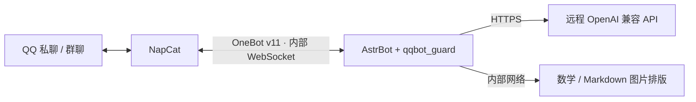

# QQ AI 聊天机器人 · Docker Compose

一套适合个人维护的 QQ AI 机器人部署方案：**NapCat + AstrBot + 远程 OpenAI 兼容 API**。使用 Docker Compose 管理；无需本地模型、Redis 或数据库服务。

保留私聊多轮对话、群聊语义判断与概率回复、不同会话隔离、文件阅读、图片/GIF 理解、按需绘图，以及数学/代码回答转图片。数学排版使用 ElegantBook Blue/Fancy；日常聊天保持简短、纯文本。

群消息下方的点赞、爱心等[表情回应](docs/reactions.md)可作为后续聊天背景，区分回应者与原消息作者；表情本身不触发一条回复。

> 这是可自行部署的通用版本。你需要自己的 QQ 账号和合法可用的模型 API。仓库没有预置 API 密钥、QQ 登录状态、个人聊天记录或管理员账号。

## 架构



| 组件 | 版本 / 用途 |
| --- | --- |
| AstrBot | v4.29.1，基于官方镜像构建附件/语音依赖扩展 |
| NapCat | 实测 v4.18.37，使用官方镜像摘要固定 |
| qqbot_guard | v1.1.0，本仓库的会话、路由和展示插件 |
| Renderer | Debian 官方基础镜像，Pandoc + XeLaTeX + Poppler |

固定镜像摘要见 [images.lock.json](images.lock.json)。版本是此配置的兼容基线，不能理解为始终最新。

## 准备条件

- Linux x86_64，Docker Engine 与 Docker Compose v2，宿主机 Python 3.9+。其他架构需重新核对官方镜像摘要与依赖。
- 建议 **2 vCPU / 4GB RAM**。2GB 可以尝试低并发运行，需要 Swap 和实测；首次构建排版镜像也需要额外内存、磁盘与时间。建议至少 15GB 可用磁盘。
- 服务器能访问 QQ、镜像源、系统软件源、Python 包源及你购买的 API 服务。
- API 至少支持 `GET /v1/models` 和 `POST /v1/chat/completions`，使用 Bearer API Key。模型名称按该接口真实返回填写。
- 不支持用这个项目覆盖已有 AstrBot/NapCat 的数据；迁移时请自行先备份、核对配置。

Docker 的安装请按 [Docker 官方 Linux 安装说明](https://docs.docker.com/engine/install/) 和 [Compose 插件说明](https://docs.docker.com/compose/install/linux/) 操作。不要在已有 Docker 服务的机器上直接运行不明来源的一键重装脚本。

## 快速部署

### 1. 下载并检查环境

以下以新目录 `/opt/qqbot` 为例；已有同名目录时请换目录，避免覆盖。

```bash
sudo git clone https://github.com/jiuxun9x/qqbot-compose.git /opt/qqbot
cd /opt/qqbot
sudo python3 scripts/preflight.py
```

脚本只检查发行版、CPU、内存、Swap、磁盘、Docker 和端口，不修改系统、防火墙或 SSH。宿主机 6185、6099 已占用时，先修改 Compose 的**宿主机端口**。

### 2. 初始化配置

```bash
sudo python3 scripts/configure.py init
```

按提示填写管理员 QQ、API Base URL、API Key，以及日常/深度/意图判断模型。Key 用隐藏输入，不放进命令参数。Base URL 例如 `https://api.example.com/v1`，请换成服务商真实地址，避免重复填写 `/v1`。

初始化会读取实际模型列表、对选择的每个聊天模型发起一次很短的测试请求，再生成 `.env`、AstrBot/NapCat 配置及插件运行配置。**这些测试会消耗少量 API 额度。** 小模型推荐使用同一服务商响应快、价格低的聊天模型；可以先与主模型复用，之后再调整。

脚本拒绝覆盖已有 `.env` 或 `data/`；失败后请先检查原因，不要直接删除已有数据。正常生成的 `.env` 权限为 `0600`，不要提交或分享。

### 3. 构建并启动

```bash
sudo docker compose build
sudo docker compose up -d
sudo docker compose ps
sudo python3 scripts/configure.py persona
```

首次构建需要下载 TeX 及附件解码依赖，耗时通常明显长于普通镜像拉取。`persona` 将 [system-prompt.txt](system-prompt.txt) 写入 AstrBot；如果 WebUI 仍在启动，稍后重试。

### 4. 安全访问 WebUI 并登录 QQ

在你自己的电脑运行，替换 SSH 用户和服务器地址：

```bash
ssh -N -L 6185:127.0.0.1:6185 -L 6099:127.0.0.1:6099 SSH用户@服务器地址
```

- AstrBot：[http://localhost:6185](http://localhost:6185)
- NapCat：[http://localhost:6099/webui](http://localhost:6099/webui)

登录信息分别在服务器 `.env` 的 `ASTRBOT_WEB_USERNAME` / `ASTRBOT_WEB_PASSWORD`、`NAPCAT_WEBUI_TOKEN` 中。在自己终端用编辑器查看即可，不要把整个文件发到群里。NapCat 中由你手动扫码登录 QQ。

OneBot 地址已经配置为 `ws://astrbot:6199/ws`，鉴权 Token 自动配对；6199 不发布到宿主机。如果 NapCat 升级后生成账号专用 OneBot 配置，请在它的 WebUI 核对反向 WebSocket 是否启用、地址和 Token 是否一致。

## 默认聊天行为

- 私聊：直接提问；不同 QQ 用户的会话隔离，保留最多 60 轮对话，同时受 token 预算限制。
- 群聊：保留本群最近 100 条公开消息作为话题背景；与每个提问者的多轮对话分开处理。**100 条公开消息不等于发送 100 轮完整模型历史。**
- 群聊主动回复默认开启：小模型判断在叫谁、是否适合回复；明确 @ 或唤醒名优先，普通插话受 **5% 概率、5 秒冷却**限制。并非每条群消息都调用模型。
- 每个群/私聊范围内同时只有一个回答任务；忙碌时继续收集后续材料。群内积压时优先明确叫机器人的消息。
- 2GB 的保守默认是全局 1 个回答任务；需要不同群与私聊并行时，实测后将运行配置 `concurrency.max_concurrent` 改为 2 或 3。同一群仍保持单回答。
- 普通聊天通常 1～2 句；解题、代码和文件分析按需要展开。失败才提示，不自动发送等待进度。
- 初始 token 预算为 32768，日常输出上限 1536，深度输出 8192；API 必须实际支持这些参数。更大上下文会增加费用和延迟，不能只看模型列表就认定支持。
- 意图判断失败时不凭猜测自动生图；`/画图` 可以明确触发。

### 常用指令

| 指令 | 作用 |
| --- | --- |
| `/help`、`/帮助` | 汇总常用及本插件新增指令；管理员会看到额外管理项 |
| `/reset`、`/new` | 清空/新建当前上下文，并取消该会话的等待材料 |
| `/stop` | 停止自己的任务或排队 |
| `/状态` | 手动查看当前处理阶段 |
| `/主动回复 开` / `关` / `状态` | 按群保存；关闭后普通消息仅真正 @ 才触发。切换需要机器人管理员 |
| `/文件自动回复 开` / `关` / `状态` | 控制发文件后是否自动分析；默认关闭，关闭时先收文件，等后续问题。群内切换需要管理员 |
| `/画图 画面描述` | 调用已配置的生图 API；也支持小模型判断自然语言重画/改风格/重发原图 |
| `/搜索 查询内容` | 调用已启用的独立搜索 API |
| `/来源` | 追问本会话最近一次检索来源；平时回答默认隐藏来源链接 |
| `/搜索池` | 管理员查看本地搜索配额计数和冷却状态 |

权限依据平台 QQ 号，不依据昵称。群友昵称、引用作者、上传者与当前发言者分别记录；引用图或文件读取失败时应说明，不能当成已经看到。

## 可选功能

见 [功能与 API 配置](docs/configuration.md)：识图、GIF、文件、生图、语音转文字、搜索 API 池、模型预算与人设修改。

这些能力取决于你使用的真实 API。**不能把普通聊天接口当成默认具备生图、语音或联网能力。**

## 运维

```bash
# 查看服务与资源
sudo docker compose ps
sudo docker stats --no-stream
free -h

# 只重启某个服务
sudo docker compose restart astrbot
sudo docker compose restart napcat

# 最近日志只在自己终端查看；避免把 QQ 登录码和消息原文公开
sudo docker compose logs --tail=80 astrbot

# 再次验证远程 API（会消耗少量额度）
sudo python3 scripts/configure.py probe

# 备份（短暂停服务，备份包含私密数据）
sudo bash scripts/backup.sh
```

更新、恢复、Swap、安全组及故障排查见 [运维说明](docs/operations.md)。所有控制面板仅监听本机；安全组入方向通常只需当前实际 SSH 端口，并限制到自己的地址。QQ 和 API 连接走出方向，无须开放 6199、6099、6185 等公网入站。

## 验证范围

[本次验证记录](docs/validation.md)：323 项回归测试通过。仓库自带测试覆盖会话隔离、队列、取消、文件收集、GIF、引用对象、图片排版标记、群聊回复策略和 API 协议等。标准 API 配置和语音协议使用本地模拟端点测试。

每个部署者仍需实测：QQ 扫码登录、收发消息、真实服务商回答、两轮记忆、群聊触发、图片/文件读取及重启后的持久化。**模拟接口通过不代表你的服务商、QQ 账号或 2GB 主机已完成端到端验证。**

## 上游与许可

感谢 [AstrBot](https://github.com/AstrBotDevs/AstrBot)、[NapCat Docker](https://github.com/NapNeko/NapCat-Docker)、[ElegantBook](https://github.com/ElegantLaTeX/ElegantBook)、Pandoc 和 TeX 社区。

本仓库自有脚本与插件采用 MIT。上游镜像、ElegantBook 类文件和 CTAN 字体/宏包保留各自许可，详见 [THIRD_PARTY_NOTICES.md](THIRD_PARTY_NOTICES.md)。
